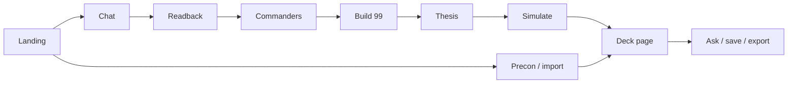
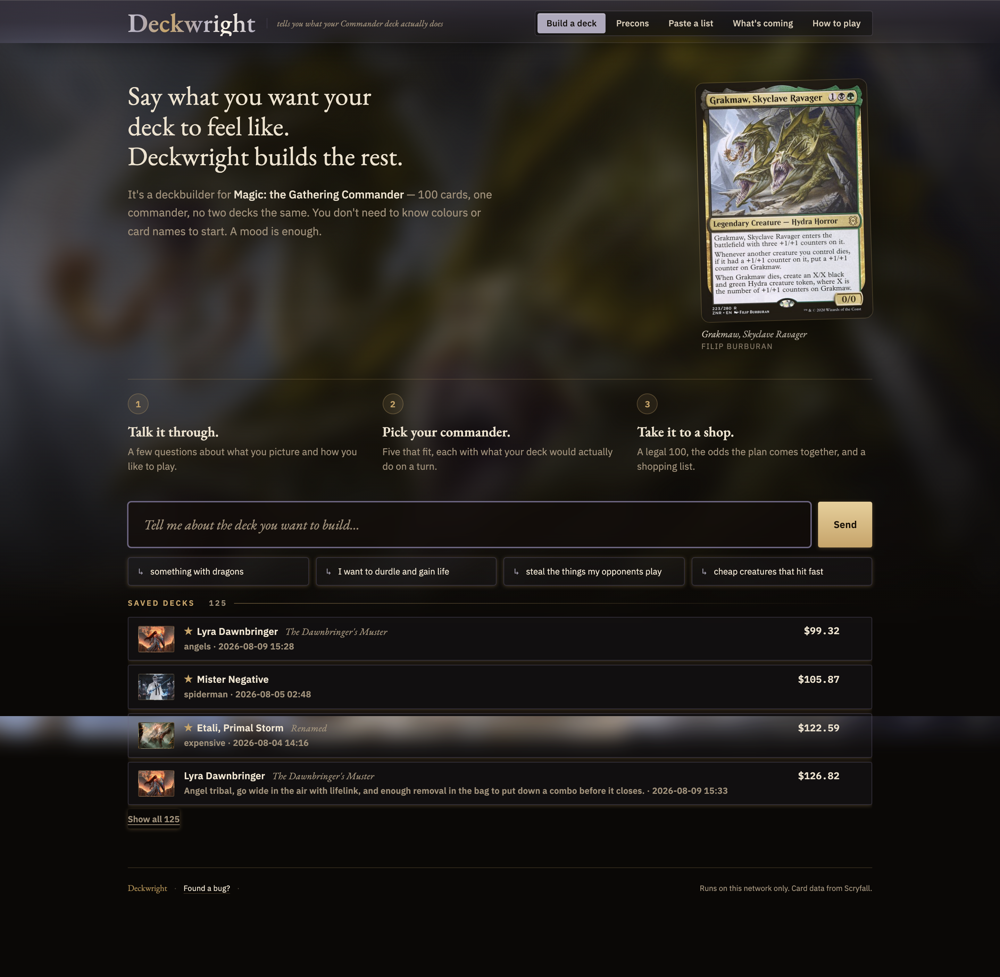
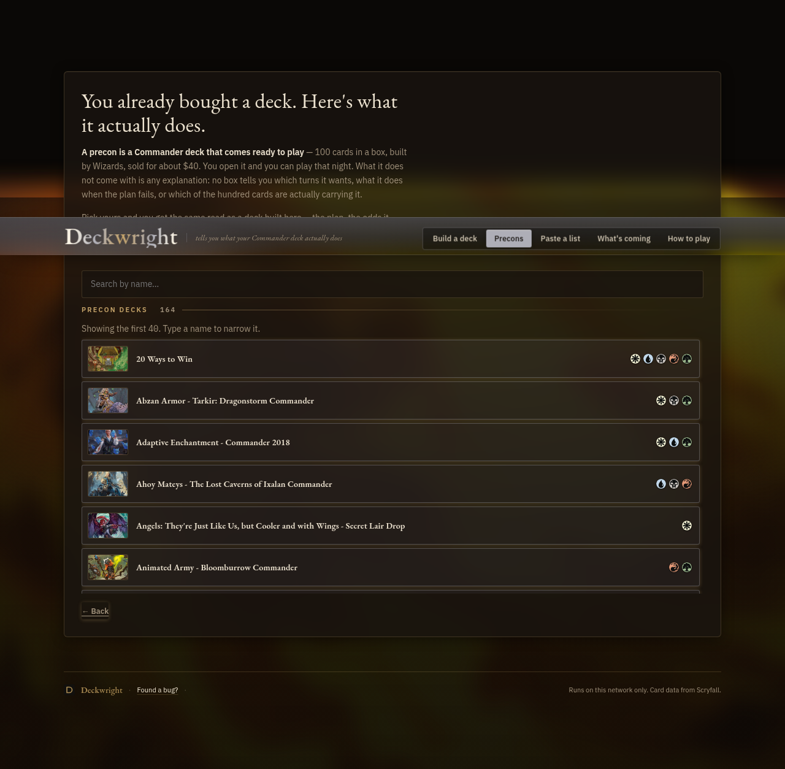

# DeckWright


DeckWright is a local Commander (EDH) deckbuilder for Magic: The Gathering. You describe the deck you want in plain English. It asks a few questions, offers real commanders, builds a legal 99 from Scryfall searches (never from card names the model remembers), and estimates how often the deck's plan comes together in solitaire goldfish games.

It runs on your own machine: one FastAPI process and one HTML page, with no build step and no database. It is not a hosted service.

## How it works



1. **Landing.** You see a short pitch, a few starter ideas, your saved decks, and doors to precons, pasting a list, and the release calendar. Nothing is built until you say what you want.

   

   The **How to play** door opens a short primer on Commander for new players:

   

2. **Chat.** You describe the deck in plain words ("something with dragons", "I want to durdle and gain life"). The app asks a few follow-up questions and keeps asking until it understands the theme well enough to search for it.

3. **Readback.** The app repeats back what it understood, term by term, with the Scryfall search behind each one. It flags terms that found nothing or could not be checked instead of pretending they are fine.

4. **Commanders.** You get five real commanders that fit, each with its colours, themes, and the ways it likes to play. "Show me more" pages through further matches, and partner pairs are offered where the rules allow.

5. **Build 99.** The app builds the 99 role by role (lands, ramp, draw, removal, the plan, the theme, a few deep cuts). Every card comes from a Scryfall search result, and any name the model suggests that is not in those results is dropped.

6. **Thesis.** The app states the plan in a few lines: what the deck is trying to do and which cards in this 99 carry it. Payoff cards must be in the deck, and the plan's conditions must be things the simulator can measure.

7. **Simulate.** The app plays thousands of solitaire goldfish games and reports how often the plan comes together and by which turn. It also calls out what it cannot model, such as effects that depend on opponents.

   

8. **Deck page.** You see the commander, legality and price, the plan, the odds, and the 99 grouped by role. The deck is saved to `~/.deckwright/` as soon as it is built. (The screenshot at the top of this README is a deck page.)

9. **Ask / save / export.** You can ask questions about the deck, stage card swaps from the same real card pools and approve or reject them, rename and keep notes, and export the list as text, an Archidekt import, or a shopping list.

   

**Side door: Precon / import.** From the landing page you can open a preconstructed Commander deck or paste a list you already own. The app analyzes it the same way and lands on the same deck page, with suggested upgrades.



## Quick start

```bash
git clone https://github.com/fairley46/deckwrightmtg.git
cd deckwrightmtg
cp .env.example .env   # optional; set ANTHROPIC_API_KEY here if you are not using the claude CLI
./run.sh               # creates .venv, installs requirements, serves http://127.0.0.1:8000
```

Open http://127.0.0.1:8000 in a browser. To check the install:

```bash
python -m deckwright.check             # preflight: Scryfall, model, simulator
python scripts/check_all.py --tier 1   # offline test gate (the same one CI runs)
```

## Requirements

- **Python 3.12+.** `run.sh` looks for a 3.12+ interpreter and refuses to start on anything older.
- **An LLM.** DeckWright needs a language model for the conversation, commander picks, and deck plan. It ships with an Anthropic Claude adapter that uses either the `claude` CLI or an `ANTHROPIC_API_KEY`. All model calls go through `deckwright/llm.py`, so supporting another model means writing one adapter; no other adapters are included.
- **Internet access to Scryfall.** Building a deck needs the live Scryfall API. Saved decks and ordinary card lookups also work from a local copy of Scryfall's bulk data, which the app downloads on first launch.
- **Optional: Java and [Forge](https://github.com/Card-Forge/forge)** for a ten-game pressure test against AI opponents. Without it the feature is hidden.

## Configuration

Settings are read from the environment or a local `.env` file (see `.env.example`). The `.env` file is gitignored; never commit a key.

| Variable | Default | What it does |
|---|---|---|
| `ANTHROPIC_API_KEY` | unset | Use the Anthropic API instead of the `claude` CLI. |
| `DECKWRIGHT_LLM` | `cli` | Set to `api` to force the API even when the CLI is installed. When the CLI is present, `run.sh` otherwise unsets the API key so nothing is billed by accident. |
| `DECKWRIGHT_LLM_TIMEOUT` | `180` | Seconds to wait for one model call. Large builds can need more. |
| `HOST` / `PORT` | `127.0.0.1` / `8000` | Where the server listens. Use `HOST=0.0.0.0` only if you want other devices on your network to reach it. |
| `DECKWRIGHT_HOME` | `~/.deckwright` | Where saved decks, the card corpus, and caches live. |
| `DECKWRIGHT_FORGE` | auto-detected | Path to the Forge desktop jar for the optional pressure test. |
| `DECKWRIGHT_PULL_ON_LAUNCH` | off | Set to `1` to `git pull --ff-only` each time `run.sh` starts. |

More operational detail (data refresh, what is stored on disk, failure modes) is in [docs/OPERATIONS.md](docs/OPERATIONS.md).

## Project layout

| Path | What it holds |
|---|---|
| `deckwright/` | The FastAPI app package (`python -m deckwright`) |
| `index.html` | The single-page UI (vanilla JS, no build step) |
| `tests/` | Offline and live tests |
| `scripts/` | The test gate, data refresh, and offline maintenance jobs |
| `data/` | Checked-in vocabularies, grammar, and reports |
| `testdata/` | Fixtures for the offline tests |
| `prompts/` | Golden-set prompts for the prompt harness |
| `docs/` | Design and operations docs; start at the [docs index](docs/README.md) |
| `run.sh` / `update.sh` | Start the app; optional maintenance (forced restart, data refresh) |

## Links

- [Docs index](docs/README.md)
- [How it connects](docs/HOW-IT-CONNECTS.md): the request path from the UI through the API to each module
- [How a wish becomes a deck](docs/DERIVATION.md)
- [Operations](docs/OPERATIONS.md) and [operating model](docs/OPERATING-MODEL.md)
- [Contributing](docs/CONTRIBUTING.md)

## Data sources and credits

- **[Scryfall](https://scryfall.com/)**: card data, legality, prices, and images. Required for builds. Requests use a descriptive `User-Agent` and stay under Scryfall's rate limit.
- **[EDHREC](https://edhrec.com/)**: optional popularity hints. If it is unreachable, deep-cut picks get less accurate and nothing fails.
- **[Archidekt](https://archidekt.com/)**: the precon catalogue and lists, read from its public JSON API at runtime and cached for 30 days. Please link back to Archidekt if you republish deck data.

DeckWright is unofficial fan content. It is not approved or endorsed by Wizards of the Coast. Magic: The Gathering is a trademark of Wizards of the Coast.

## License

MIT. See [LICENSE](LICENSE).
