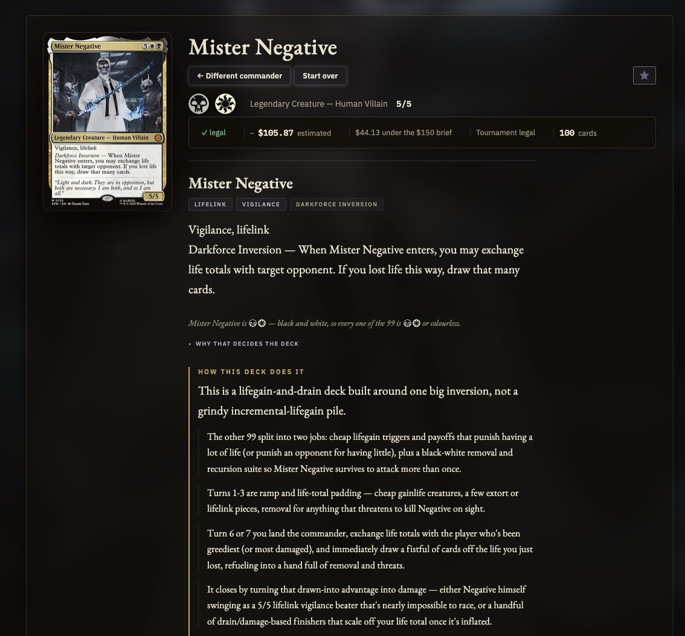
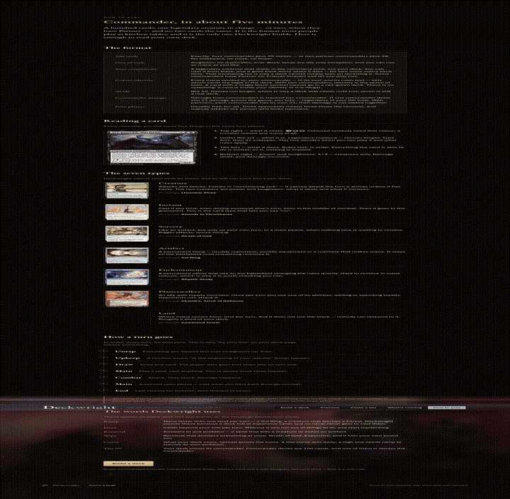
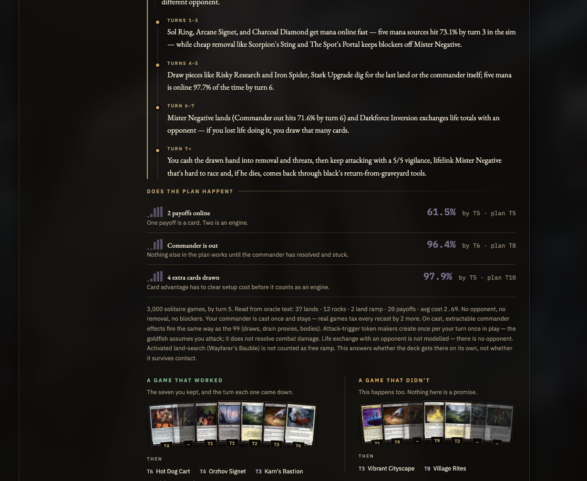
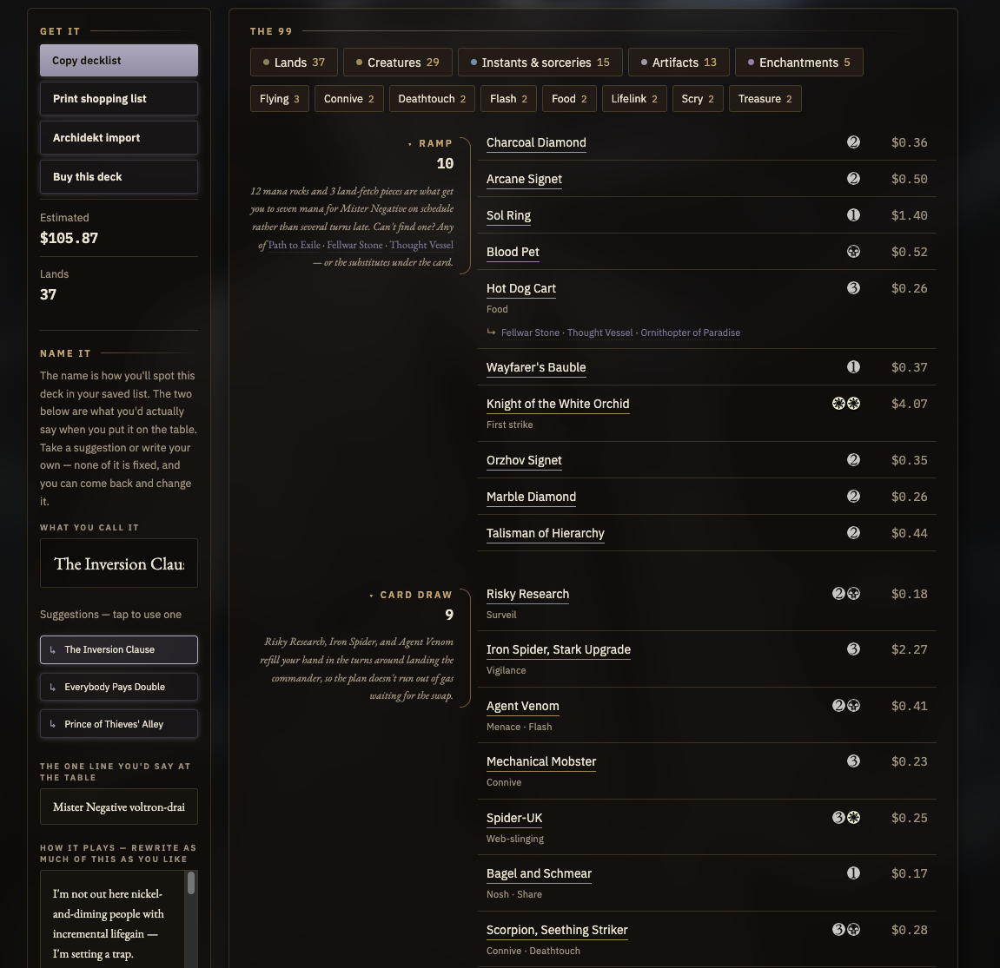

# DeckWright



DeckWright turns a plain-English Commander idea into a legal 99-card list grounded in Scryfall. You describe how the deck should feel. It asks a few questions, offers real commanders, builds the 99 from Scryfall queries (not invented card names), and measures how often the plan fires in solitaire goldfish games.

Needs an LLM. Ships with an Anthropic Claude adapter (API key or `claude` CLI); all model calls go through `deckwright/llm.py`, so another frontier model is one adapter away.

This is a **local** app: one FastAPI process, one HTML file, no build step, no database. It is not a hosted public service.



## Quick start

```bash
# Python 3.12+, plus either ANTHROPIC_API_KEY or the `claude` CLI on PATH
cp .env.example .env   # optional; defaults bind localhost
./run.sh               # http://127.0.0.1:8000
```

Open that URL in a browser. Preflight and the offline gate:

```bash
python -m deckwright.check
python scripts/check_all.py --tier 1
```

## What you get

After a build, the deck is written under `~/.deckwright/` and kept on the open page. You can ask about the plan and numbers, stage card swaps, re-run the odds, and export a list you can take to a shop.





Copy the list, print a shopping list, or import it to Archidekt.

## Where things live

| Path | Job |
|---|---|
| `deckwright/` | FastAPI app package (`python -m deckwright`) |
| `index.html` | Single-page UI |
| `tests/` | Offline and live test files |
| `scripts/` | Merge gate and offline jobs |
| `config/` | Optional install helpers |
| `data/` | Checked-in bakes and reports (precon bakes are fetched/baked locally) |
| `docs/` | Living docs — start at the [docs map](docs/README.md) |

How the pieces connect: [docs/HOW-IT-CONNECTS.md](docs/HOW-IT-CONNECTS.md). Contributor notes: [docs/CONTRIBUTING.md](docs/CONTRIBUTING.md).

## Data sources

- **Scryfall** — card data, legality, prices, images. Required for builds.
- **EDHREC** — optional popularity / average-deck hints. Benchmark fixtures under `data/benchmarks/edhrec/` are not committed; regenerate with `python scripts/harvest_edhrec_benchmark.py` when that script is present.
- **Archidekt** — precon catalog and lists via their public read JSON API. DeckWright identifies with a descriptive `User-Agent`, stays under ~8 req/s, and caches the catalog for 30 days under `~/.deckwright/precons.json`. Lists are fetched at runtime (and optionally baked with `scripts/bake_precons.py`); baked JSON is not committed. Please [link back to Archidekt](https://archidekt.com/) when you republish deck data. See [docs/OPERATIONS.md](docs/OPERATIONS.md).

Card data from Scryfall; popularity hints from EDHREC; precon lists from Archidekt. Unofficial fan content. Not approved or endorsed by Wizards of the Coast.

## License

MIT — see [LICENSE](LICENSE).
