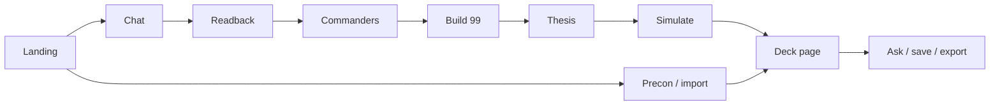

# DeckWright


DeckWright turns a plain-English Commander idea into a legal 99-card list grounded in Scryfall. You describe how the deck should feel. It asks a few questions, offers real commanders, builds the 99 from Scryfall queries (not invented card names), and measures how often the plan fires in solitaire goldfish games.

Needs an LLM. Ships with an Anthropic Claude adapter (API key or `claude` CLI); all model calls go through `deckwright/llm.py`, so another frontier model is one adapter away.

This is a **local** app: one FastAPI process, one HTML file, no build step, no database. It is not a hosted public service.


## How it works



1. **Landing.** You see a short pitch, a few starter ideas, your saved decks, and doors to precons, pasting a list, and the release calendar. Nothing is built until you say what you want.

   

   The **How to play** door opens a short primer on Commander for new players:

   

2. **Chat.** You describe the deck in plain words ("something with dragons", "I want to durdle and gain life"). The app asks a few follow-up questions and keeps asking until it understands the theme well enough to search for it.

3. **Readback.** The app repeats back what it understood, term by term, with the Scryfall search behind each one. It flags terms that found nothing or could not be checked instead of pretending they are fine.

4. **Commanders.** You get five real commanders that fit, each with its colours, themes, and the ways it likes to play. "Show me more" pages through further matches, and partner pairs are offered where the rules allow.

5. **Build 99.** The app builds the 99 role by role (lands, ramp, draw, removal, the plan, the theme, a few deep cuts). Every card comes from a Scryfall search result, and any name the model suggests that is not in those results is dropped.

6. **Thesis.** The app states the plan in a few lines: what the deck is trying to do and which cards in this 99 carry it. Payoff cards must be in the deck, and the plan's conditions must be things the simulator can measure.

7. **Simulate.** The app plays thousands of solitaire goldfish games and reports how often the plan comes together and by which turn. It also calls out what it cannot model, such as effects that depend on opponents.

   

8. **Deck page.** You see the commander, legality and price, the plan, the odds, and the 99 grouped by role. The deck is saved to `~/.deckwright/` as soon as it is built. (The screenshot at the top of this README is a deck page.)

9. **Ask / save / export.** You can ask questions about the deck, stage card swaps from the same real card pools and approve or reject them, rename and keep notes, and export the list as text, an Archidekt import, or a shopping list.

   

**Side door: Precon / import.** From the landing page you can open a preconstructed Commander deck or paste a list you already own. The app analyzes it the same way and lands on the same deck page, with suggested upgrades.


## Quick start

```bash
# Python 3.12+, plus either ANTHROPIC_API_KEY or the `claude` CLI on PATH
cp .env.example .env   # optional; defaults bind localhost
./run.sh               # http://127.0.0.1:8000
```

Open that URL in a browser. Preflight and the offline gate:

```bash
python -m deckwright.check
python scripts/check_all.py --tier 1
```

## What you get

After a build, the deck is written under `~/.deckwright/` and kept on the open page. You can ask about the plan and numbers, stage card swaps, re-run the odds, and export a list you can take to a shop.


Copy the list, print a shopping list, or import it to Archidekt.

## Where things live

| Path | Job |
|---|---|
| `deckwright/` | FastAPI app package (`python -m deckwright`) |
| `index.html` | Single-page UI |
| `tests/` | Offline and live test files |
| `scripts/` | Merge gate and offline jobs |
| `config/` | Optional install helpers |
| `data/` | Checked-in bakes and reports (precon bakes are fetched/baked locally) |
| `docs/` | Living docs — start at the [docs map](docs/README.md) |

How the pieces connect: [docs/HOW-IT-CONNECTS.md](docs/HOW-IT-CONNECTS.md). Contributor notes: [docs/CONTRIBUTING.md](docs/CONTRIBUTING.md).

## Data sources

- **Scryfall** — card data, legality, prices, images. Required for builds.
- **EDHREC** — optional popularity / average-deck hints. The benchmark's EDHREC fixtures (`data/benchmarks/edhrec/`) are not committed and no script in this tree regenerates them; without them the benchmark reports the E contestant as unknown.
- **Archidekt** — precon catalog and lists via their public read JSON API. DeckWright identifies with a descriptive `User-Agent`, stays under ~8 req/s, and caches the catalog for 30 days under `~/.deckwright/precons.json`. Lists are fetched at runtime (and optionally baked with `scripts/bake_precons.py`); baked JSON is not committed. Please [link back to Archidekt](https://archidekt.com/) when you republish deck data. See [docs/OPERATIONS.md](docs/OPERATIONS.md).

Card data from Scryfall; popularity hints from EDHREC; precon lists from Archidekt. Unofficial fan content. Not approved or endorsed by Wizards of the Coast.

## License

MIT — see [LICENSE](LICENSE).
