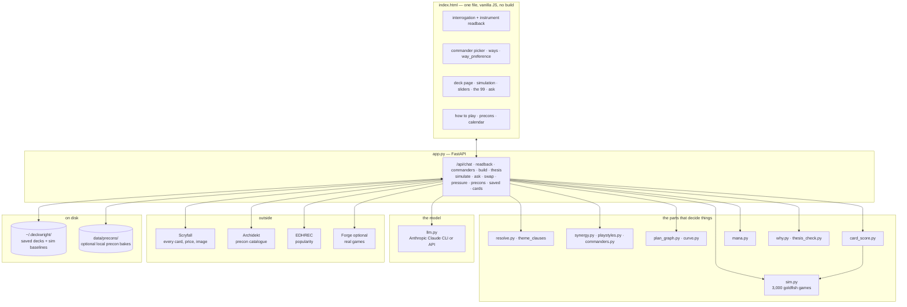
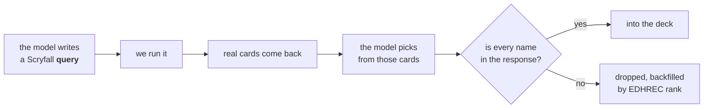
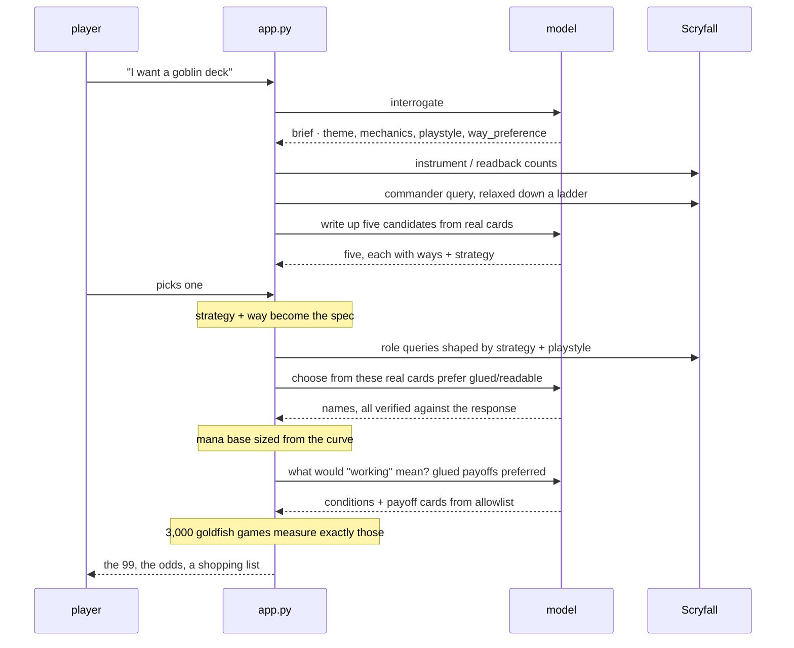

# How DeckWright is put together

One FastAPI process, one HTML file, no build step, no database. Everything below
is a consequence of that.

**Docs map (entry order, where files live):** [README.md](README.md).

**Connection spine (journey, modules, verifiers, persistence):**
**[HOW-IT-CONNECTS.md](HOW-IT-CONNECTS.md)**. Read that when you need "how A joins B."

Needs an LLM. Ships with an Anthropic Claude adapter (API key or `claude` CLI);
all model calls go through `deckwright/llm.py`, so another frontier model is one
adapter away. See [OPERATIONS.md](OPERATIONS.md). Contributor rules:
[CONTRIBUTING.md](CONTRIBUTING.md).

---

## The shape

## The one rule

**The model never writes a card name from memory.** It writes queries; we run
them; every name it returns is checked against the actual response. This happens
in `/api/commanders`, `/api/build` and `/api/thesis`, and it is the only thing
keeping the output real. If you refactor, keep the verifier in all three.

**An unknown is not a zero.** Empty means "none" or "could not look" — never collapse
a failed look into a real zero.

## A deck, end to end

Detail and module table: [HOW-IT-CONNECTS.md](HOW-IT-CONNECTS.md). Short sequence:

## What decides what

The pipeline has one spine: **the strategy chosen at commander-pick time is the
spec for everything after it.**

| Stage | Reads | Decides |
|---|---|---|
| Interrogation | the player's words | theme, mechanics, playstyle, **way_preference**, table |
| Instrument / readback | theme spans | live Scryfall counts (ok / empty / unknown) |
| Commander | brief + ways | five candidates; soft-prefer mapped way |
| Skeleton | playstyle + curve | role slot counts (`SKELETON_LIVE`) |
| Role queries | strategy, mechanics | which cards are even offered |
| Card choice | pool + glue | which of those make it (prefer readable / glued) |
| Mana base | the finished curve | land count, basics as residue |
| Thesis | strategy + glued payoffs | what "working" means for *this* deck |
| Simulation | thesis | how often it happens, by which turn |
| Ask (incl. saved) | deck + recomputed instrument | improve answers from real candidates |

Colour is not on that list on purpose. **Colour identity is an output of
choosing a commander**, never an input — that is Commander's own rule, and it
runs opposite to every other format.

## Where the bodies are buried

Three failure modes this codebase keeps producing. All three shipped at least
once, and all three passed their tests.

**Silent extraction.** `sim.py` reads rules text with regexes. A miss doesn't
raise, it just scores a card zero and shifts every probability downstream.
Azusa's "play two additional lands" slipped past a regex matching only "an
additional land". When a number looks wrong, check the diagnostics line under
the chart before suspecting the simulation.

**Player words that aren't card words.** "Ramp", "removal", "wipe" describe what
a card does *to a player*; no card prints them. `o:ramp` returns Embercleave.
Anything derived from prose must resolve through `classify()` against Scryfall's
real vocabulary before it becomes a query.

**Wrong meter.** A Keychain API key with no credits, or a launchd PATH that hides
the `claude` CLI, makes every model call look broken. `./run.sh` prefers the CLI, and
`python -m deckwright.check` prints which one is in use.

**A backend with no caller.** Features have landed complete and done nothing
because the frontend never called them. Green tests, merged change, no effect.
Check the call site.

## Deliberately absent

No database, no auth, no Docker, no frontend build, no multi-user. It is a
single-user local app; each of those would add work for users it does not have.

A saved deck is a JSON file. Older ones simply lack newer fields, and the app
checks rather than assuming — which is the entire migration story. Ask recomputes
instrument counts; it does not freeze them as truth on disk.
