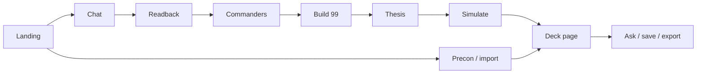

# How Deckwright connects

**Source of truth for the connection spine.** Re-checked against `main` on
2026-08-09 (GA wrap · CON-267 on tip). If this file and `SYSTEM-MAP.md` disagree,
**trust this file, then the code.**

Companions: [README.md](README.md) (docs map · where things live) ·
[ARCHITECTURE.md](ARCHITECTURE.md) (shape) · [DERIVATION.md](DERIVATION.md)
(QC stages) ·
[OPERATIONS.md](OPERATIONS.md) (LLM adapter, sanctity) ·
[CONTRIBUTING.md](CONTRIBUTING.md) (contributor rules).

---

## One sentence

Her words become live Scryfall counts, a brief, five real commanders, a verified
99 (prefer cards we can read and that glue to the commander), a thesis we can
measure, 3,000 goldfish games, and a shopping list — and ask on a saved deck
**recomputes** the instrument instead of trusting frozen counts.

## The through-line (CON-255)

```
instrument → understand → Scryfall queries → real cards
         → prefer readable / glued → rank by edges / sim lift
```

| Hop | Code | What it does |
|---|---|---|
| **Instrument** | `build_readback` → `build_instrument` → `messages_with_instrument` | Scryfall counts for what she said (local corpus first — CON-294). Status: `ok` / `empty` / `unknown`. Unknown ≠ zero. |
| **Understand** | `INTERROGATOR` → `extract_brief_payload` → `apply_way_fields` → `check_readiness`; commanders: `theme_fit` / `strategy_fit` / ways; build: `plan_graph.derive` | Brief + way_preference → way_playstyle; plan commitments. |
| **Queries** | `resolve.resolve_theme` / `theme_clauses` / `commander_ladder` / `role_query` / `plan_graph.payoff_searches` / `synergy.synergy_recall_queries` → `search_ladder` | Real Scryfall syntax. Never invent card names here. |
| **Real cards** | `scry()` / `search()` → **local corpus** (`corpus.py`, `~/.deckwright/oracle_cards.jsonl`) first; live API for `otag:`/`art:` (Tagger) and anything the index cannot parse → model chooses **names from the pool** | Verifier drops anything not in the response. Local data is still real data. Unsupported ≠ empty. CON-308 splits composite AND-conjuncts — local content serves from disk; unevaluated `otag:`/`art:` marks the result incomplete, not a smaller match. **Build still needs live Scryfall** — role ladders are `otag:`-heavy (CON-303); corpus protects reads, not `/api/build`. |
| **Prefer** | `synergy.prefer_glued`, `prefer_way_playstyle`, `precon_upgrade.card_is_readable`, thesis glued allowlist | Soft prefer — not a hard filter that invents coverage. |
| **Rank** | `card_score.rank_for_role` (sim lift + edge steer); EDHREC as backfill order | Measured lift for the plan, not popularity alone. |

---

## Journey (frontend → API → modules)



### 1. Landing

| | |
|---|---|
| UI | Starters, saved list (`GET /api/saved`), import / precon / calendar doors |
| API | `GET /`, `GET /api/saved`, `GET /api/boot` (CON-285) |
| State | Empty brief; optional saved decks from `~/.deckwright/` |

**Desktop boot (CON-285):** `run.sh` fail-open pulls code; process lifespan runs
`boot.run_boot` — warm vocab; if data stale: cadence `--kb` (new words / synergy
objects / commander mechanics) then `print_wave_reeval` (coverage + playstyles).
Does not admit new signals or strategies. Brand veil waits on `/api/boot`
(`refreshing` → `understanding` → `ready`); skipped when KeepAlive is already warm.
**CON-295:** boot also probes live Scryfall into `card_source`. A Cloudflare
challenge / rate limit / timeout is named on the landing; `ready` stays true so
saved decks still open. Build/search surface the same kinds — never a generic
500, and never a harder retry.

### 2. Chat — interrogation + instrument

| | |
|---|---|
| UI | `POST /api/chat` with `{messages, readiness_asked}` |
| API | `chat()` |
| Pipeline | `theme_hint_for_instrument` → `build_instrument` → `messages_with_instrument` → model (`INTERROGATOR`) → `extract_brief_payload` → `apply_way_fields` → `check_readiness` → `strip_pool_magnitudes_for_handoff` → `build_narrowing_turn` → closing empty/unknown honesty + narrowing prose |
| Out | `{text, brief, still_asking, readiness, instrument, narrowing}` |

**CON-287:** healthy theme-pool magnitudes are suppressed at handoff (builder
diagnostic). Empty/unknown stay graded. Narrowing names a few real commanders
that differ by `ways_to_play` — not a card-pool size. `INTERROGATOR` prompt
text is unchanged (Box); the payload shape is ready for a later prompt edit.

**Brief fields that load the rest of the spine:** `theme`, `angle`, `colors`,
`mechanics`, `playstyle`, **`way_preference` / `way_playstyle`**, `budget_total`,
`bracket`, `commander_query`, `flavor_terms`.

If `readiness.ready` is false, she stays in chat — the app does not pretend a
thin theme is ready.

### 3. Readback

| | |
|---|---|
| UI | `POST /api/readback` |
| API | `readback()` → `build_readback` + `build_narrowing_turn` |
| Modules | `resolve` (place terms), `compose_pool_query`, `count_matching`, commanders KB (`theme_fit` / `strategy_fit` / ways) |
| Out | Per-term `{said, query, count, display}` where `count` is `int` or `null`; `display` is empty/unknown/thin only (healthy pool sizes suppressed); `narrowing` candidates with distinct lead ways |

**CON-287:** the UI shows labelled empty/unknown/thin only — never an unlabelled
"278 angels" pool size. Between understanding and the picker, `narrowing`
surfaces a few Scryfall-real commanders that differ by way to play.

### 4. Commanders (+ partners)

| | |
|---|---|
| UI | `POST /api/commanders` (`offset`) → pick → optional `POST /api/partners`; **Show me more** pages the same rung (CON-189). Each pick shows type / colours / themes / signals / ways (CON-286) — not template prose. |
| API | `commanders()` → `enrich_commander_pick` |
| Pipeline | `apply_way_fields` → `commander_ladder` → `search_primary_rung` / `search_paginated` (`total_cards`, never fetch-cap as total) → `prefer_way_playstyle` → `rank_commanders_pool` → `page_commanders` → KB fit / ways / `picker_differs` → optional model blurbs on page 0 only, **verifier-filtered**; `fits` is write-up only (`writeup_missing` when absent) |
| Out | Five picks + `differs` + `rung_total` / `shown_of` / `has_more` / `rung_exhausted`; exhausted does not silently descend |

**Colour:** identity is usually an *output* of the commander — but if she named
colours in the brief, `brief_color_identity` scopes the commander ladder.

### 5. Build the 99

| | |
|---|---|
| UI | `POST /api/build` `{brief, commander, partner, pick, conversation, card_pool}` |
| API | `build()` |
| Pipeline | Merge pick strategy into brief → fetch commander card(s) → `plan_graph.derive` → payoff + synergy recall pools → per **role** (`ROLES`): `role_query` → `search_ladder` → model names → **verifier + `backfill_chosen`** → `card_score.rank_for_role` → floors → `mana.plan` / lands → flex via `synergy.prefer_glued` → `why.annotate` / `synergy.cohesion` / `overview.generate_overview` (`llm.can_call`) → `persist_deck` |
| Out | Full deck record (see Persistence) |

Roles (targets conventional, not sacred): lands **0** (curve-filled), ramp 10,
draw 9, spot 7, wipe 3, plan 10, theme 15, deepcut 5. Live skeleton may reshape
(`curve.SKELETON_LIVE`).

### 6. Thesis

| | |
|---|---|
| UI | `POST /api/thesis` |
| API | `thesis()` |
| Pipeline | Prefer `plan_graph.thesis_from_plan` (plan stamped on the build, or `derive` from brief + commander) → conditions = plan conditions; payoffs = glued names from the 99 (role fallback). **Model thesis only when no measurable plan** — `build_thesis_user_message` → model → **verifier**: payoff names ⊆ deck; condition keys ⊆ `sim.THESIS_KEYS` |
| Out | `{payoff_cards, conditions, source: "plan"|"model", glued_* diagnostics}` |

### 7. Simulate

| | |
|---|---|
| UI | `POST /api/simulate` (optional composition tweak) |
| API | `simulate()` |
| Pipeline | optional `tweak.apply_tweak` on `role_pools` → `sim.run` (3000, `commander_card` for on-cast oracle — CON-268) → `thesis_check.review` (spread / payoffs / focus / **key support** / **commander-story mismatch** — CON-267/268) → baseline stamp (`bake` + `SIM_VERSION`) when untweaked. Extractable commander effects fire on cast like the 99; opponent life-exchange stays unmodelled and is called out, not green-washed. |
| Out | Curves, diagnostics, review caveat |

### 8. Deck page / ask / save / export

| Action | API | Connection rule |
|---|---|---|
| **Ask** | `POST /api/ask` | `enrich_ask_context` **recomputes** instrument + improve candidates from `role_pools`; `ask_prompt_facts` → `DECKTALK`. Never invent upgrade names. |
| **Swap / suggest** | `/api/swap`, `/api/suggest` | Alternates only from real pools. Suggest stages a pending change set (`set_id`); `/pending/approve` forks `vN→vN+1`; `/pending/reject` drops the set and leaves the 99 alone (CON-271 / D1). |
| **Christen / save** | `/api/christen`, `PATCH /api/saved/{id}` | Identity on disk; sim baseline separate |
| **Match notes** | `GET/POST /api/saved/{id}/notes`, `DELETE …/notes/{note_id}` | Post-game notes on disk via `deck_state` — no model (CON-270 / CON-128) |
| **Export** | (strings on deck record) | Archidekt text + TCGplayer mass-entry. Moxfield is **import** shape. |
| **Pressure** | `/api/pressure*` | Optional Forge — not on the critical path |

### 9. Precon / paste import

| Path | API | Notes |
|---|---|---|
| Precon catalogue | `GET /api/precons`, `POST /api/precons/{id}` | Bake from `data/precons/` when fresh; else live Archidekt → analyze → `attach_precon_upgrade` (ways + readable/glued upgrades). **POST persists** via `persist_deck` (CON-309) — catalogue browse (`GET`) does not. |
| Paste | `POST /api/import` or `/api/resolve` | **`/api/resolve` = decklist import**, not theme resolve. Shared tail `analyze_imported_deck` calls `persist_deck` so the response carries `id` / `saved_at` (CON-309). |

---

## Module map

| Module | Job | On the spine? |
|---|---|---|
| `deckwright/app.py` | Routes, ladders, verifiers, persistence, instrument | Yes — hub |
| `llm.py` | Anthropic Claude CLI (default) or API | Yes — all model calls |
| `resolve.py` | Word → Scryfall operator | Yes — theme / readiness |
| `synergy.py` | Edges, prefer_glued, recall, cohesion (`unknown`/`unread` ≠ orphan), glued payoffs | Yes — prefer + thesis/ask |
| `plan_graph.py` | Plan commitments + payoff searches | Yes — build |
| `playstyles.py` | Detect + map `way_preference` | Yes — commanders / ask |
| `commanders.py` | KB theme/strategy fit + ways | Yes — picker |
| `curve.py` | Live skeleton + castability report | Yes — build |
| `mana.py` | Land / source plan | Yes — build |
| `card_score.py` | Marginal sim lift per role | Yes — build |
| `sim.py` | `mechanics()` + goldfish; `THESIS_KEYS` | Yes — score + simulate |
| `why.py` / `thesis_check.py` | Explain / QC thesis | Yes — build / sim |
| `overview.py` | Build-time sim + overview prose | Yes — build |
| `precon_*` / `import_deck.py` | Precons + paste | Side door → same deck page |
| `swap.py` / `suggest.py` / `tweak.py` | Verified edits | Deck page |
| `bake.py` / `deck_state.py` | Hash / versions / notes | Persistence |
| `pressure.py` | Optional Forge | Optional |
| `coverage.py` / `christen.py` / `release_calendar.py` | Coverage ask, naming, calendar | Adjacent |

---

## The three verifiers (sacred)

Search `app.py` for these — line numbers drift.

| Endpoint | Rule |
|---|---|
| `/api/commanders` | Model write-ups kept only if `name` ∈ Scryfall candidate set |
| `/api/build` | Per role: `chosen = [valid[n] for n in names if n in valid]` then `backfill_chosen` from the real pool |
| `/api/thesis` | `payoff_cards` ⊆ deck names; condition keys ⊆ `sim.THESIS_KEYS` (12 keys) |

Related: `overview` verifies named cards; christen strips non-deck names; swap/tweak
only touch `role_pools`.

**The model never writes a card name from memory.**

---

## Persistence — frozen vs recomputed

### On disk: `~/.deckwright/{slug}.json`

Frozen when she saves / auto-save after build:

- The 99, commander, brief, plan, `role_pools`, conversation, overview prose
- Optional `simulation` baseline stamped with `deck_hash` + `sim.SIM_VERSION`

**Green (CON-315)** is a second process (`(local launchd label)`,
`:8001`, `DECKWRIGHT_HOME=~/.deckwright-green`). It shares
`oracle_cards.jsonl` read-only. It is not a spine hop. Production `:8000` is
never the experiment. Install: `./config/install-green-launchd.sh`. Details in
[OPERATIONS.md](OPERATIONS.md).

**B clarity (CON-321 Gate 2):** when green runs `DECKWRIGHT_CANDIDATE=B`,
`/api/build` and import attach `commander_strategy` + `strategy_audit` and
paint `#clarity`. Candidate `off` on `:8001` keeps **BLUE** = V1 for the bake-off.

**B steer (CON-321 Gate 4):** same flag, when the commander reads, soft-steers
the 99 during build (backfill, placement, sim tiebreak, flex fill). Never drops
cards. `bound_ok == unknown` is neutral. Unread → V1 path. Harness contestant
**B** hits `:8002`; **BLUE** hits `:8001` with `off`. Bound `op` is `leq` or
`geq` (CON-331 floors); steer and audit share one checker.

**C ServeReport (CON-322):** when green runs `DECKWRIGHT_CANDIDATE=C` (`:8003`),
same B clarity + steer, plus per-card `serve_report` from `cardfacts.lookup`
(`feeds_input` / `consumes_output` / `bound_ok` / `concept_hits` /
`weighted_serve`). Missing facts → unknown, not zero. Harness contestant **C**
→ `DECKWRIGHT_GREEN_C_URL` default `:8003`. Not the default path.

**Not frozen as truth:**

- Ask **instrument** counts — `enrich_ask_context` rebuilds from Scryfall every ask
- Stale sims — stripped when hash / `SIM_VERSION` mismatch (`bake.strip_stale`)

### In repo: `data/`

Grammar, commanders KB, playstyles, synergy objects, coverage / print-wave
reports. Precon lists are fetched from Archidekt at runtime (optional local bake
via `scripts/bake_precons.py`; baked JSON is not committed). Cadence:
`scripts/refresh_data_cadence.sh` + `scripts/print_wave_reeval.py`.

---

## House rules (load-bearing on every hop)

1. **Unknown ≠ zero.** Instrument statuses, `count_matching` → `None`, readiness
   `pool_unknown`. A failed Scryfall look is not "0 cards." Same for
   `cardfacts.lookup` (CON-322): missing store/card → `None`, not `{}`.
2. **Fallback ≠ match.** Ladder rungs that widen must not be reported as the
   theme matching.
3. **Strategy at pick time is the spec** for build and thesis.
4. **LLM adapter.** Needs an LLM. Ships with Anthropic Claude (API key or
   `claude` CLI). `llm.make_client()` / `./run.sh` prefer the CLI when present;
   `llm.can_call` gates overview without requiring an API key. All model calls
   go through `deckwright/llm.py`.

### CardFacts (CON-322) — bake offline; serve on candidate C only

`cardfacts.extract` + `scripts/bake_cardfacts.py` bake structured facts offline
from the local corpus into `cardfacts.json` (resume/skip-existing +
checkpoints for a full demo-host bake). `scripts/cardfacts_status.py` reports
store tallies. Build reads CardFacts only behind `DECKWRIGHT_CANDIDATE=C`
(`serve_report` / CF-informed steer). BLUE and B do not. Gate: no B
promotion, no C-as-default, no CardFacts in `app.py` / `card_score`.
Offline B-vs-C compare: [`docs/benchmarks/B-VS-C.md`](benchmarks/B-VS-C.md).
Remaining: [`docs/product/C-REMAINING.md`](product/C-REMAINING.md).

---

## Side doors (same deck page)

```
Precon bake/live ──┐
Paste import ──────┼──→ analyze / overview / sim ──→ deck page
Saved reopen ──────┘         ask recomputes instrument
```

---

## How to keep this file honest

When you change a route or a through-line hop:

1. Update **this file** in the same PR.
2. Do not invent a parallel "system map" section that contradicts it.
3. `SYSTEM-MAP.md` is a deep inventory — useful, but secondary. Its banner points here.
4. QC stage checks still live in `DERIVATION.md`.

```bash
# Sanity: routes and helpers still exist
rg -n "def (chat|readback|commanders|build|thesis|simulate|ask|enrich_ask_context|build_instrument)\b" app.py
rg -n "prefer_glued|glued_payoff_candidates|map_way_playstyle" synergy.py playstyles.py
```
